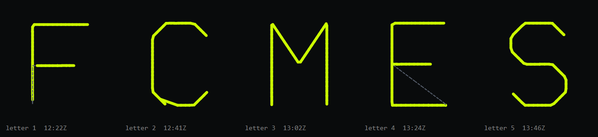

# Squawk

Success code: `F5EFF597`. Access code: **FCMES**.



## Run it

Windows PowerShell 5.1, no installs.

```powershell
.\solve.ps1 -Email you@example.com    # fetch token + traffic, decode, write letters.png and data\radar-data.js
.\solve.ps1 -Offline -Check           # rerun on the saved feed and verify a guess with POST /check
```

Then open `radar.html` in a browser for the replay.

## How it was solved

1. The page had a hidden ATIS broadcast (`--squawk-ghost`, two shades off the background) describing `/squawk`, `/traffic` and `/check`.
2. `/traffic` returned 11,958 position reports for 40 airframes. Several aircraft flash 7700 for a second or two while changing codes, one sits parked on the ground at Nassau on 7700, and `N7700K` is a VFR Piper whose registration contains 7700. Only **ENY4890 (hex `ab4889`)** holds 7700 airborne: 92 minutes circling east of Nassau.
3. Its track is skywriting. Altitude flips between two bands about 1,300 ft apart: the lower band is pen down, the higher band is the pen lifted while it flies a repositioning loop back to the start point. All letters are drawn over the same patch of sky on a grid rotated about 21 degrees off north (pen-down headings cluster at 339/069/159/249).
4. Keeping only pen-down strokes, rotating by 21 degrees and splitting letters at long pen-up loops gives F, C, M, E, S. `POST /check` confirmed it.

## Data cleaning

- Timestamps mix epoch seconds and milliseconds; anything above 1e11 is divided by 1000.
- Tracks are keyed by ICAO hex, not callsign: some reports have blank callsigns and `ENY4890` is broadcast by two different airframes.
- Exact duplicate reports are dropped and each track is time-sorted (the feed is shuffled).
- A fix is rejected if reaching it from the last accepted fix would need more than 1.5x the reported ground speed + 120 kt (46 glitch fixes removed).
- A 7700 only counts as an emergency if it is held while airborne, which removes the dial-through blips.

## Files

| File | What |
| --- | --- |
| `solve.ps1` | End-to-end solver: fetch, clean, find the emergency, decode, render, verify |
| `radar.html` | Animated radar scope replay with a live "readback" panel that writes the letters as they are flown |
| `letters.png` | The decoded skywriting, one panel per letter |
| `radar-screenshot.png` | The replay at the end of the final letter |
| `data/` | Raw feed and the cleaned tracks used by the replay (`-Offline -Check` also wants your token in `data/token.txt`) |
| `exploration/` | The throwaway scripts and plots from working it out |
| `TRANSCRIPT.md` | The full AI session (Cursor agent) that solved it |
